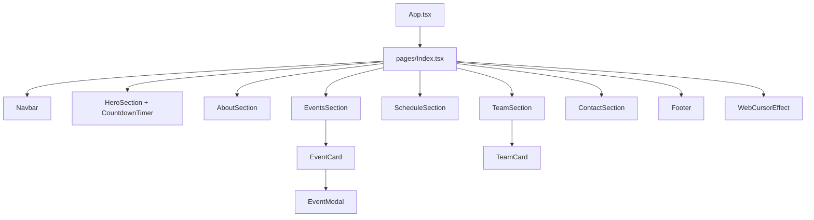

<div align="center">


</div>

## 📌 Overview

REDRON is a single-page event website: a hero section with a countdown timer, an about section, an events grid with a detail modal, a schedule, a team section and a contact/footer area, all wrapped in a custom web-themed cursor effect. It's built as a React + TypeScript + Vite app on top of shadcn/ui, and is deployed live on Vercel.

## ✨ Features

- 🕸️ Custom animated cursor effect (`WebCursorEffect`) for a distinctive feel
- ⏱️ Live countdown timer to the event date
- 🗓️ Events grid with cards that open a detail modal (`EventCard` + `EventModal`)
- 📋 Schedule section laying out the event timeline
- 👥 Team section with team member cards
- 📬 Contact section and footer
- 🎨 Full shadcn/ui + Radix component library for consistent UI primitives
- ✅ Unit tests (Vitest) and end-to-end tests (Playwright)

## 🛠️ Tech Stack

| Layer | Technology |
|---|---|
| Framework |    |
| UI |    |
| Forms / Data | React Hook Form · Zod · TanStack Query |
| Animation |  |
| Testing |   |
| Deployment |  |

## 🏗️ Architecture



## 📂 Project Structure

```
Redron-26/
├── public/
├── src/
│   ├── assets/
│   ├── components/
│   │   ├── ui/                 # shadcn/ui primitives
│   │   ├── HeroSection.tsx
│   │   ├── AboutSection.tsx
│   │   ├── EventsSection.tsx
│   │   ├── EventCard.tsx
│   │   ├── EventModal.tsx
│   │   ├── ScheduleSection.tsx
│   │   ├── TeamSection.tsx
│   │   ├── TeamCard.tsx
│   │   ├── ContactSection.tsx
│   │   ├── CountdownTimer.tsx
│   │   ├── Navbar.tsx / NavLink.tsx
│   │   ├── Footer.tsx
│   │   └── WebCursorEffect.tsx
│   ├── hooks/
│   ├── lib/
│   ├── pages/
│   │   ├── Index.tsx
│   │   └── NotFound.tsx
│   ├── test/
│   └── main.tsx
├── playwright.config.ts
├── vitest.config.ts
└── vite.config.ts
```

## ⚙️ Installation

```bash
git clone https://github.com/Fayaz-2007/Redron-26.git
cd Redron-26

npm install
npm run dev
```

No `.env` file is required for local development.

## 🚀 Usage

```bash
npm run dev       # start the Vite dev server
npm run build      # production build
npm run test       # run Vitest unit tests
npx playwright test # run Playwright end-to-end tests
```

Live site: **https://web-slinger-events.vercel.app**

`[Screenshot: hero section with countdown]`

`[Screenshot: events grid + modal]`

## 🔮 Future Improvements

- Hook the events grid up to a real backend/CMS instead of static data
- Add a registration/RSVP flow with form validation
- Expand Playwright coverage to the events and schedule flows
- Add dark/light theme toggle (next-themes is already a dependency)
- SEO metadata and Open Graph tags for social sharing

## 👨‍💻 Author

**Fayaz Ahmed**
GitHub: [@Fayaz-2007](https://github.com/Fayaz-2007)
LinkedIn: [fayaz-ahmed-59287631a](https://linkedin.com/in/fayaz-ahmed-59287631a)

<div align="center">


</div>
